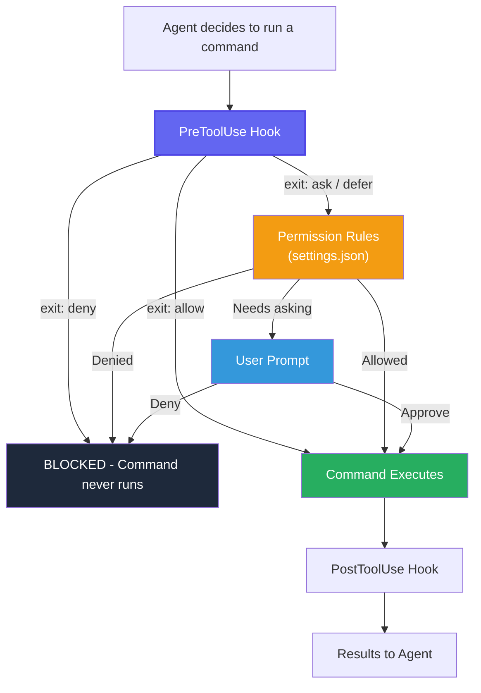

# oc-policy-gate

Namespace-scoped access control for AI coding agents operating on OpenShift/Kubernetes clusters.

| Agent | Status |
|-------|--------|
| Claude Code | Supported |
| Codex (local CLI) | Supported |
| Cursor | Coming soon |

A policy gate for `oc`, `kubectl`, and `helm` commands with verb-level permissions per namespace. Claude uses a `PreToolUse` hook; Codex uses command rules and a `PermissionRequest` hook.

> Codex uses `PermissionRequest` because its `PreToolUse` hook can deny commands but cannot currently approve them in a way that skips the normal approval flow. See the [Codex docs](https://learn.chatgpt.com/docs/hooks#permissionrequest).

## Why

AI agents need cluster access to debug and deploy. Unrestricted access is dangerous — an agent can read secrets, modify resources, or operate in namespaces it shouldn't touch. This hook enforces boundaries without restricting the agent's native tooling.

- **Zero token overhead** — no MCP schemas loaded into context
- **Explicit denials** — block matching tool calls; see the Codex limitations below
- **Native tooling** — agents use `oc`/`kubectl`/`helm` directly, no wrappers

## Quick Start (Claude Code)

For Codex, use the [Codex setup](#codex-setup).

### 1. Copy files into your project

```bash
# Option A: git subtree (recommended — enables pulling updates)
git remote add oc-policy-gate https://github.com/rh-ai-quickstart/oc-policy-gate.git
git subtree add --prefix=.claude/hooks oc-policy-gate master --squash

# Option B: manual copy
mkdir -p .claude/hooks
cp openshift-policy.sh openshift-policy.yaml test-openshift-policy.sh .claude/hooks/
```

### 2. Configure your policy

Edit `.claude/hooks/openshift-policy.yaml` with your namespaces and permissions:

```yaml
namespaces:
  my-app-dev:
    oc: [read, write, exec]
    helm: [read, write]
  my-app-staging:
    oc: [read, write]
    helm: [read]
  my-app-prod:
    oc: [read]
    helm: [read]
```

**Permission groups:**

| Tool | Group | Verbs |
|------|-------|-------|
| oc | `read` | get, describe, logs, events, top, explain, status, diff, wait, auth can-i, rollout status, rollout history |
| oc | `write` | apply, create, patch, delete, scale, label, annotate, set, run, edit, replace, expose, autoscale, rollout restart, rollout undo, rollout pause, rollout resume |
| oc | `exec` | exec, debug, port-forward, cp, attach |
| helm | `read` | template, lint, list, status, get, show, history, search, verify, dependency list, repo list, plugin list |
| helm | `write` | install, upgrade, dependency update, dependency build |
| helm | `destructive` | uninstall, rollback, delete |

### 3. Wire up the hook

Create `.claude/settings.json` with the following contents, or merge them into your existing settings:

```json
{
  "permissions": {
    "deny": [
      "Read(./.claude/hooks/**)",
      "Edit(./.claude/hooks/**)",
      "Write(./.claude/hooks/**)"
    ]
  },
  "hooks": {
    "PreToolUse": [
      {
        "matcher": "Bash",
        "hooks": [
          {
            "type": "command",
            "if": "Bash(*oc *)",
            "command": "${CLAUDE_PROJECT_DIR}/.claude/hooks/openshift-policy.sh",
            "timeout": 5
          },
          {
            "type": "command",
            "if": "Bash(*kubectl *)",
            "command": "${CLAUDE_PROJECT_DIR}/.claude/hooks/openshift-policy.sh",
            "timeout": 5
          },
          {
            "type": "command",
            "if": "Bash(*helm *)",
            "command": "${CLAUDE_PROJECT_DIR}/.claude/hooks/openshift-policy.sh",
            "timeout": 5
          }
        ]
      }
    ]
  }
}
```

## Codex setup

Both clients use the same `openshift-policy.sh`, namespace rules, verb groups,
shell parsing, and default namespace. The script defaults to Claude's
`PreToolUse` response; `--client codex` selects Codex's `PermissionRequest`
response. It requires Bash, `jq`, and `yq`; Python is only used by the tests.
The configuration was checked with Codex CLI 0.163.0.

### 1. Install the hook files

From your project's root, copy the files from your downloaded gate directory
(replace `/path/to/oc-policy-gate` with its location):

```bash
mkdir -p .codex/hooks .codex/rules
cp /path/to/oc-policy-gate/openshift-policy.sh /path/to/oc-policy-gate/openshift-policy.yaml .codex/hooks/
```

### 2. Configure your policy

Edit `.codex/hooks/openshift-policy.yaml` as for Claude. An empty policy retains
the full-permission default namespace described below. To share one policy
between both clients, set `OPENSHIFT_POLICY_FILE` to the same file in both
hook commands.

### 3. Require approval for cluster commands

Create `.codex/rules/cluster.rules` directly with the following contents:

```python
prefix_rule(
    pattern = [["oc", "kubectl", "helm"]],
    decision = "prompt",
    justification = "Cluster command requires review. Verify namespace and verb before execution.",
    match = ["oc get pods", "kubectl get pods", "helm list"],
    not_match = ["git status", "helmfile version"],
)
```

The rule requires approval for matching invocations, so Codex runs the
`PermissionRequest` hook before showing a prompt. The `match` and `not_match`
entries are examples Codex checks when loading the rule; they do not run those
commands. The rule file uses Starlark, not JSON.
See [OpenAI's command rules](https://learn.chatgpt.com/docs/agent-configuration/rules).

This matches command prefixes, not every Bash string containing those words.
Codex can split simple command chains such as `cd app && helm list`, but complex
shell expressions, commands inside script files, and absolute executable paths
may not match this rule. Those invocations are not guaranteed to reach the
hook. See [shell matching limits](https://learn.chatgpt.com/docs/agent-configuration/rules#shell-wrappers-and-compound-commands)
and [OpenAI's command-rule boundaries](https://learn.chatgpt.com/docs/enterprise/security-cookbook#let-developers-use-codex-while-protecting-production).

### 4. Wire up the approval hook

Create `.codex/hooks.json` directly as a regular file with the following
contents, or merge this entry into your existing configuration. Remove this
gate's previous `PreToolUse` entry; keep any unrelated hooks. JSON does not
allow `//` comments.

```json
{
  "hooks": {
    "PermissionRequest": [
      {
        "matcher": "^Bash$",
        "hooks": [
          {
            "type": "command",
            "command": "bash \"$(git rev-parse --show-toplevel)/.codex/hooks/openshift-policy.sh\" --client codex",
            "timeout": 10,
            "async": false,
            "statusMessage": "Checking OpenShift approval request"
          }
        ]
      }
    ]
  }
}
```

### 5. Load and trust the configuration

Restart Codex to load `.codex/rules/cluster.rules` and `.codex/hooks.json`.
Project-local hooks and rules require a trusted project. Open `/hooks` to
review and trust the hook; changed definitions require review again.
Use an approval mode that permits prompts so these rules can trigger the
`PermissionRequest` hook.

Codex also supports hook configuration in `config.toml`, but this guide uses
`hooks.json`; avoid registering the same hook in both places.
See [OpenAI's hook configuration](https://learn.chatgpt.com/docs/config-file/config-advanced#hooks)
and [hook trust documentation](https://learn.chatgpt.com/docs/hooks#review-and-trust-hooks).

### What differs from Claude

The Codex flow is:

```text
Command matches the prompt rule
  → PermissionRequest hook
  → Bash checker evaluates the policy and returns Codex JSON
  → allow: run / deny: block / no decision: ask the user
```

There is one synchronous handler with a ten-second timeout. It runs when
Codex needs approval, rather than on every Bash call. Its matcher is `^Bash$`,
which also covers `exec_command`. Other Bash commands that need approval can
also trigger this handler; the checker returns no decision for text without
an `oc`, `kubectl`, or `helm` word. Codex has no documented equivalent to
Claude's command-content `if` filter.
See [Codex's matcher documentation](https://learn.chatgpt.com/docs/hooks#matcher-patterns).
The hook command resolves the script from the Git root, following
[OpenAI's configuration example](https://learn.chatgpt.com/docs/hooks#config-shape).

The shared `allow()` and `deny()` functions select the response format for the
chosen client. Claude remains the default, so existing hook commands keep
working; `--client claude` is also accepted. Codex's `PermissionRequest` expects
`decision.behavior` instead of Claude's `PreToolUse` `permissionDecision`.
The policy checks are shared; no Python adapter is needed.

| Shared checker result | Codex `PermissionRequest` |
|-----------------------|---------------------------|
| allow | `decision.behavior: "allow"`; run without showing the prompt |
| deny | `decision.behavior: "deny"`, preserving the reason |
| ask (empty output, exit 0) | No decision; show the normal approval prompt |

The rule requires an approval decision, not necessarily a human click: the
hook can approve a policy-allowed command automatically. Unknown namespaces
and ungranted verbs keep the normal approval prompt when this rule matches.
See [Codex's event contract](https://learn.chatgpt.com/docs/hooks#permissionrequest).

In Codex mode, a missing or non-string `tool_input.command` produces no output
and exits successfully: no decision, leaving normal approval behavior unchanged.
An unexpected event or tool also produces no decision.

If the running checker detects a missing dependency or another failure that
causes its main shell process to exit unsuccessfully, it returns an explicit
denial. This does not catch every possible internal error, such as failures
inside shell process substitutions. A hook that cannot start or times out is not guaranteed to block the command.

## Pulling Updates (git subtree)

```bash
git subtree pull --prefix=.claude/hooks oc-policy-gate master --squash
```

## How It Works

Every command in Claude Code passes through a gate pipeline:



1. **allow** — command runs without user prompt
2. **deny** — command is blocked (missing namespace, output redirect)
3. **ask** — leaves the normal permission flow in charge (unknown namespace, unrecognized verb); a prompt is not guaranteed

**Always denied:** commands without `-n <namespace>`, output redirects (`> file`)

**Auto-allowed (no namespace needed):** `oc version`, `oc whoami`, `helm template`, `helm version`, etc.

## Running Tests

```bash
bash test-openshift-policy.sh
python3 -m unittest -v test_openshift_policy_codex.py
```

The shared checker has 107 cases covering read/write/exec verbs, namespace
enforcement, pipes, compound commands, redirects, multi-word verbs, and default
namespace derivation. The Codex tests exercise the `PermissionRequest` contract, dependency
failures, invalid input, and the documented hook command from a subdirectory
with spaces. All proposed
cluster commands are test input only; the tests never run them.

After installing the rules, check their matching without executing a cluster
command:

```bash
codex execpolicy check --pretty --rules .codex/rules/cluster.rules -- oc get pods
```

The result should report `"decision": "prompt"`. Repeat with `kubectl get pods`
and `helm list`. This tests rule matching; it does not prove a running Codex
session has loaded or trusted the hook.

## Default Namespace (empty policy fallback)

When `openshift-policy.yaml` has no namespaces configured (empty `namespaces:` key or missing file), the hook automatically derives a **deterministic default namespace** from the local environment:

```
opg-{repo-basename, max 30 chars}-{os-username, max 20 chars}
```

The result is lowercased, non-alphanumeric characters are replaced with hyphens, consecutive hyphens are collapsed, and trailing hyphens are stripped. Maximum length is 54 characters (within Kubernetes' 63-char limit).

Example: repo `nvidia-rag-blueprint`, user `jdoe` → namespace `opg-nvidia-rag-blueprint-jdoe`

The derived namespace receives **full permissions** — oc: `read,write,exec`; helm: `read,write,destructive`. Once you add any explicit namespace to the policy YAML, the fallback is disabled entirely.

### Why the agent must not derive the namespace itself

The policy hook exists to **constrain** the agent. If the agent were allowed to read the policy file and compute the default namespace on its own, it would have access to the very configuration that enforces its boundaries — undermining the security model. Instead, the derivation lives inside the hook (which the agent cannot read or modify), and the agent's skill definitions embed a **copy of the same function** so both sides arrive at the same namespace independently.

This separation means:
- The hook computes the namespace to decide **what to allow**
- The skill computes the namespace to decide **what to target**
- Neither side needs to read the other's configuration

### Using the derivation in skills

Embed this function in your skill or subagent prompt so the agent can derive the namespace without accessing the policy files:

```bash
derive_default_ns() {
  local repo_root repo_base user default_ns
  repo_root="$(git rev-parse --show-toplevel 2>/dev/null)" || repo_root="$PWD"
  repo_base="$(basename "$repo_root")"
  user="$(whoami)"
  repo_base="$(echo "${repo_base:0:30}" | tr '[:upper:]' '[:lower:]' | sed 's/[^a-z0-9-]/-/g; s/-\+/-/g; s/-$//')"
  user="$(echo "${user:0:20}" | tr '[:upper:]' '[:lower:]' | sed 's/[^a-z0-9-]/-/g; s/-\+/-/g; s/-$//')"
  default_ns="opg-${repo_base}-${user}"
  echo "$default_ns" | sed 's/-$//'
}
```

The agent runs this function, gets the namespace string, and uses it with `-n` on every `oc`/`helm` command. The hook independently derives the same string and auto-allows the commands — no policy file access needed on either side.

## Customization

Set `OPENSHIFT_POLICY_FILE` environment variable to use a policy file from a different location:

```bash
OPENSHIFT_POLICY_FILE=/path/to/my-policy.yaml
```
